<p align="center">
  <a href="https://nunoamorim.dev"></a>
</p>

<p align="center">
  <a href="https://nunoamorim.dev"></a>
  <a href="https://www.linkedin.com/in/nunoamorim99"></a>
  <a href="mailto:nunomamorim99@gmail.com"></a>
  <a href="https://beaglechomp.nunoamorim.dev"></a>
</p>


### `01` — Profile

Product Manager at **Foco Criativo**, and an engineer who never stopped shipping. I came up through code - intern, Software Engineer, then Product Owner, then Product Manager, all on the same product in two years - and I still write code today. Staying close to the craft is deliberate: it means I prototype an idea instead of describing it, and I write specs engineers can actually build from.

The work I care most about right now is applied AI. Not research - **building**. Foundation models in the loop, real products, real users, and an honest read on where AI creates value versus where it's just noise.

I don't think you understand a technology until you've built something with it. Everything below is me finding out.


### `02` — Education

**M.Sc. Information Systems Engineering & Management** · Universidade do Minho · 2019 – 2024


### `03` — Product: Movize

<p align="center">
  <a href="https://movize.pt/">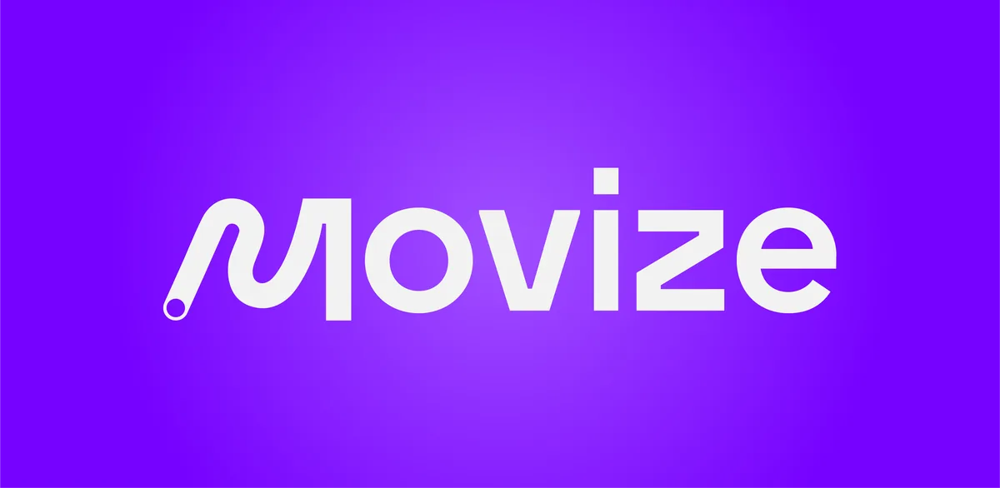</a>
</p>

<p align="center"><i>Centralising Portugal's urban transport - and giving operators the tools to go digital.</i><br/>
<sub>Product Manager · Product Owner · 2024 – present &nbsp;·&nbsp; <a href="https://movize.pt/">movize.pt</a> &nbsp;·&nbsp; <a href="https://movize.app/">movize.app</a> &nbsp;·&nbsp; <a href="https://nunoamorim.dev">case study</a></sub></p>

<table>
  <tr>
    <td width="33%" valign="top"><sub>THE PROBLEM</sub><br/>Portugal had no native app that brought every urban-transport operator together. Riders juggled scattered sources - or went without - just to plan a trip across operators and modes.</td>
    <td width="33%" valign="top"><sub>THE PIVOT</sub><br/>Integrating operators surfaced the real problem: most of them, especially the small ones, had <b>no digital tooling at all</b> and couldn't afford to hire someone to digitise their network.</td>
    <td width="33%" valign="top"><sub>THE ECOSYSTEM</sub><br/>So Movize grew from an app into a platform: rider apps on top, and <b>Movize Connect</b> underneath, where operators, event organisers and infrastructure owners manage their own data.</td>
  </tr>
</table>

**For riders** - routes, stops and schedules from every operator in one place.

<table>
  <tr>
    <td width="33%">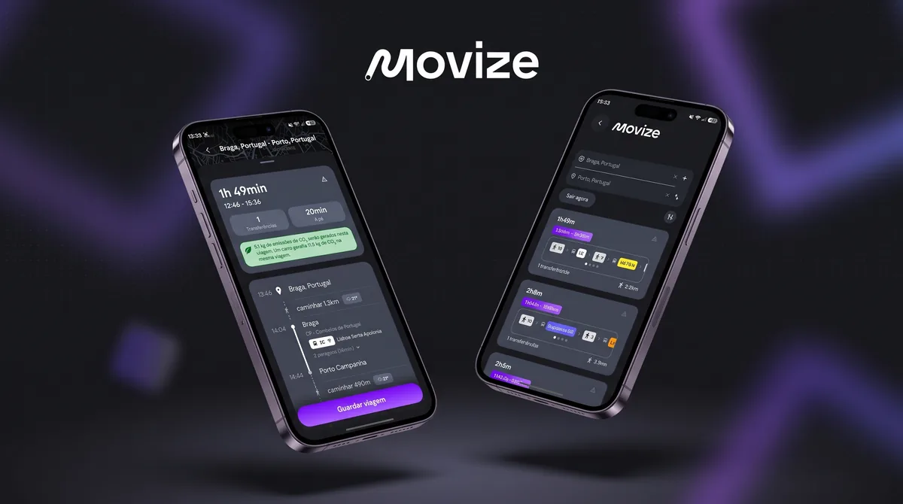</td>
    <td width="33%"><a href="https://movize.app/">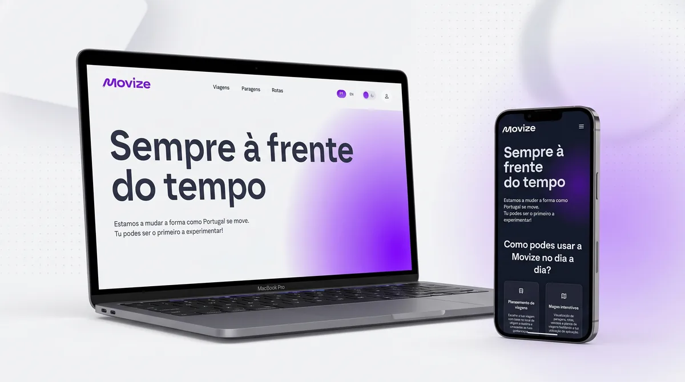</a></td>
    <td width="33%"><a href="https://movize.pt/">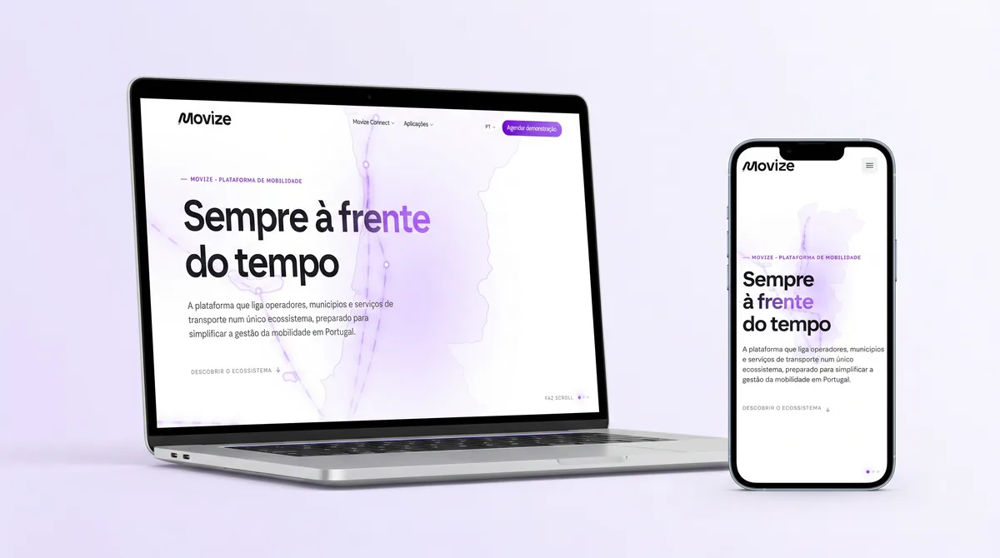</a></td>
  </tr>
  <tr>
    <td valign="top"><b>Mobile app</b><br/><sub>iOS &amp; Android. Multimodal trip planning across operators, built in React Native + Expo.</sub></td>
    <td valign="top"><b><a href="https://movize.app/">Web app</a></b><br/><sub>The core experience in any browser, with a deliberately narrower scope than the native app.</sub></td>
    <td valign="top"><b><a href="https://movize.pt/">Website</a></b><br/><sub>The front door: turns a multi-product platform into a simple pitch for operators and municipalities.</sub></td>
  </tr>
</table>

**For operators - Movize Connect**, the back office, built module by module.

<table>
  <tr>
    <td width="33%">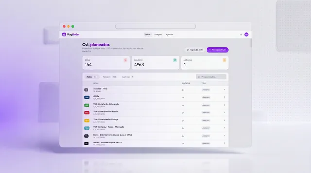</td>
    <td width="33%">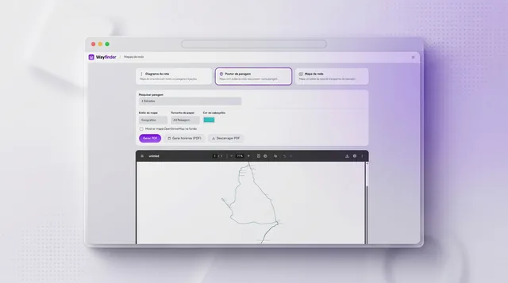</td>
    <td width="33%">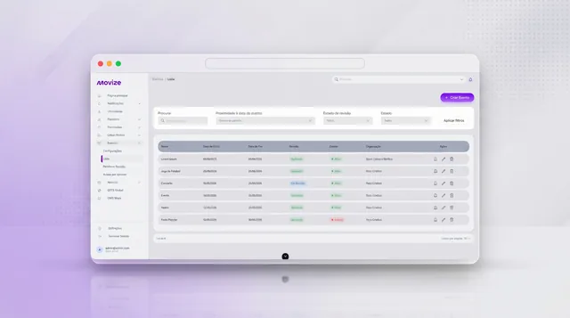</td>
  </tr>
  <tr>
    <td valign="top"><b>GTFS Management</b><br/><sub>Build GTFS feeds from scratch, so even un-digitised networks can come online.</sub></td>
    <td valign="top"><b>Network Map</b><br/><sub>Design and maintain the network map riders see in the app.</sub></td>
    <td valign="top"><b>Events</b><br/><sub>Organisers publish events together with the dedicated routes and buses serving them.</sub></td>
  </tr>
  <tr>
    <td>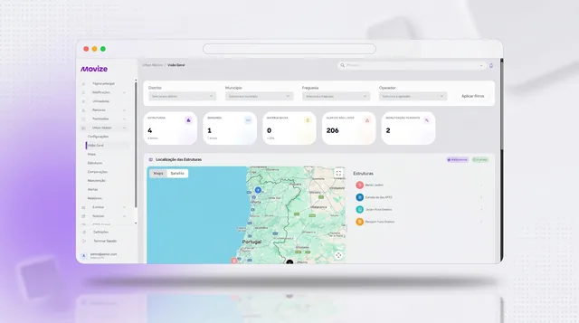</td>
    <td>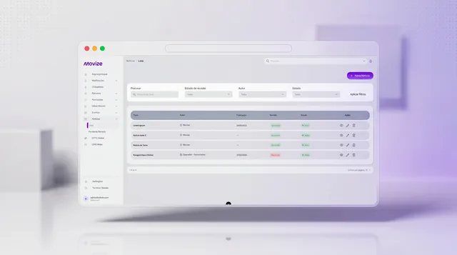</td>
    <td>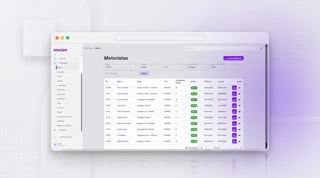</td>
  </tr>
  <tr>
    <td valign="top"><b>Street Furniture &amp; Sensors</b><br/><sub>Shelters, stops and LoRaWAN sensors on a map, with the data they collect.</sub></td>
    <td valign="top"><b>News</b><br/><sub>Service updates published straight to riders.</sub></td>
    <td valign="top"><b>Drivers</b><br/><sub>Fleet and driver management, with a companion driver app.</sub></td>
  </tr>
</table>

**Decisions I'd make again**
- **Bet on the ecosystem, not just the app.** Helping small operators digitise was the unlock for rider coverage *and* a sustainable business model.
- **Prioritise the operator portal.** The back office is where the ecosystem's value - and its path to revenue - actually lives.
- **Ship Events as a growth bet.** Events already run dedicated transport but had nowhere to announce it; the module drives real-world usage and keeps the app full of timely content.
- **Build feedback into the product.** Riders, operators and admins are connected directly, so real pain points surface fast instead of getting lost in a backlog.

**My part:** I own the roadmap end to end, run discovery and validation with operators and riders, write the stories the team builds from - and still ship front-end code.

> *"Exactly what Portugal needs."* - the feedback that keeps coming back from riders and operators as new modules roll out.

<sub>Platform: React Native + Expo · Vue 3 · Python (FastAPI) microservices over gRPC · Symfony · OpenTripPlanner · PostgreSQL + PostGIS · Redis · MQTT / LoRaWAN · Google Kubernetes Engine. Closed source - the full story is in my <a href="https://nunoamorim.dev">portfolio</a>.</sub>


### `04` — Claude Code plugins

If a model is part of how the team works, the product-management layer has to live where the model can actually see it. Not in Jira - in the repo. So I built it, and then kept going: five [Claude Code](https://docs.claude.com/en/docs/claude-code) plugins that cover the work around the code - ideas, sprints, stakeholder docs and product protection. Plain Markdown, no database, nothing to host.

<table>
  <tr>
    <td width="38%" align="center"><a href="https://github.com/nunoamorim99/agile-ledger-pro"><picture><source media="(prefers-color-scheme: dark)" srcset="assets/logos/agile-ledger-pro-dark.svg"></picture></a><br/><sub><b>NEW</b> · flagship</sub></td>
    <td valign="top">The next generation of Agile-Ledger. Backlog, sprints, board, velocity, releases and bug tracking from <b>34 slash commands</b> - or from a <b>local dashboard</b> in the browser. Adds <code>/insights</code> for velocity, forecast and flow, a lossless switch between <b>Scrum and Kanban</b>, and per-person identity for teams sharing one ledger repo.</td>
  </tr>
  <tr>
    <td align="center"><a href="https://github.com/nunoamorim99/agile-ledger"><picture><source media="(prefers-color-scheme: dark)" srcset="assets/logos/agile-ledger-dark.svg"></picture></a></td>
    <td valign="top">The full Scrum lifecycle - ideas → epics → sprints → releases, plus bugs - as plain Markdown in a dedicated ledger repo. GitHub holds the code; this holds the <i>why</i>, joined by the user-story ID through every branch, commit and PR.</td>
  </tr>
  <tr>
    <td align="center"><a href="https://github.com/nunoamorim99/idea-ledger"><picture><source media="(prefers-color-scheme: dark)" srcset="assets/logos/idea-ledger-dark.svg"></picture></a></td>
    <td valign="top">Capture ideas mid-work with <code>/idea</code>, track how each one evolves, version what ships - in two Markdown files. One invariant: nothing is ever deleted.</td>
  </tr>
  <tr>
    <td align="center"><a href="https://github.com/nunoamorim99/cartographer"><picture><source media="(prefers-color-scheme: dark)" srcset="assets/logos/cartographer-dark.svg"></picture></a></td>
    <td valign="top">Reads a project's repos and writes the stakeholder docs nobody wants to write - what each product does, never how it's built. Audience-aware Markdown + PDF, with staleness checks.</td>
  </tr>
  <tr>
    <td align="center"><a href="https://github.com/nunoamorim99/fortify"><picture><source media="(prefers-color-scheme: dark)" srcset="assets/logos/fortify-dark.svg"></picture></a><br/><sub><b>NEW</b></sub></td>
    <td valign="top">How easily can your product be reverse engineered, cracked, scraped or cloned? A read-only scan, a full audit across <b>five clone vectors</b> with a tiered protection plan in plain language, and a harden step that applies fixes one reviewable change at a time. Defensive only, <b>15 platforms</b>.</td>
  </tr>
</table>

All five live in one marketplace - [`nunoamorim99/claude-skills`](https://github.com/nunoamorim99/claude-skills):

```
/plugin marketplace add nunoamorim99/claude-skills
/plugin install agile-ledger-pro@nunoamorim99
```


### `05` — Beagle Chomp

<p align="center">
  <a href="https://beaglechomp.nunoamorim.dev"></a>
</p>

<p align="center"><i>A 3D maze chase where every single pixel is drawn in code.</i></p>

<p align="center">
  
  
  
  
</p>

It started as an excuse to learn three.js by building something real with it - a classic maze-chase, remade in 3D, starring the beagle my partner and I keep saying we'll get. Then the product side kicked in: a leaderboard whose scores can be trusted, a shop that sells *dogs* with powers instead of skins, a challenge ladder, and player accounts that collect no personal data. When I hit the wall of shaping a character by typing coordinates, I built the editor I was missing.

<table>
  <tr>
    <td align="center"><b>0</b><br/><sub>model, texture or<br/>audio files shipped</sub></td>
    <td align="center"><b>36</b><br/><sub>mazes</sub></td>
    <td align="center"><b>40</b><br/><sub>Journey levels</sub></td>
    <td align="center"><b>114</b><br/><sub>challenges</sub></td>
    <td align="center"><b>8</b><br/><sub>worlds, each with<br/>its own soundscape</sub></td>
    <td align="center"><b>~1,600</b><br/><sub>test assertions</sub></td>
  </tr>
</table>

- **Everything is generated at runtime.** Characters are sculpted from swept solids and revolved profiles, surfaces are painted to a canvas, and ~1,600 lines of Web Audio synthesise every sound and ambient bed.
- **The game logic never imports three.js.** It's pure TypeScript that runs headless in Node - which is how the server can reuse the game's own rules to validate every submitted score.
- **Full-stack since v5.** Installable PWA on the front, a Hono + PostgreSQL API behind it, deployed on Cloudflare Pages and Hetzner.

<sub>TypeScript · three.js · Vite · PWA · Web Audio · Canvas 2D · Hono · PostgreSQL · Zod · argon2id · Playwright · Docker</sub>

<p align="center">
  <a href="https://beaglechomp.nunoamorim.dev"><b>▶ Play it</b></a> &nbsp;·&nbsp; <a href="https://github.com/nunoamorim99/beagle-chomp">Source</a> &nbsp;·&nbsp; <a href="https://nunoamorim.dev">Case study</a>
</p>


### `06` — More games

Games are unforgiving in a way that CRUD apps aren't: the loop either works or it doesn't, and no architecture diagram saves you. Both were built with a model in the loop, which was half the point - finding out where it excels as a coding partner and where it needs steering.

<table>
  <tr>
    <td width="50%"><a href="https://nunoamorim99.github.io/nibble/"></a></td>
    <td width="50%"><a href="https://nunoamorim99.github.io/AstroHop/"></a></td>
  </tr>
  <tr>
    <td valign="top"><b><a href="https://github.com/nunoamorim99/nibble">Nibble</a></b> &nbsp;<a href="https://nunoamorim99.github.io/nibble/">▶ play</a><br/><sub>The Nokia snake, evolved into a neon PWA - Classic and Level modes, composable challenge modifiers, a coin economy for themes and skins, and a Supabase-backed global leaderboard. A deterministic, fully unit-tested engine, built with eight specialised Claude Code subagents.<br/><br/>TypeScript · Canvas · Vite · Vitest · Supabase</sub></td>
    <td valign="top"><b><a href="https://github.com/nunoamorim99/AstroHop">Astro Hop</a></b> &nbsp;<a href="https://nunoamorim99.github.io/AstroHop/">▶ play</a><br/><sub>A retro 2D platformer, and an excuse to learn game feel properly - power-up state machines, tilemap levels, mobile touch controls, and every sound synthesised live with the Web Audio API. Zero audio files.<br/><br/>Phaser 3 · Vite · Web Audio</sub></td>
  </tr>
</table>


### `07` — Stack

<sub>**LANGUAGES**</sub><br/>

<sub>**FRONT-END & MOBILE**</sub><br/>

<sub>**3D, GAMES & AUDIO**</sub><br/>

<sub>**BACK-END & DATA**</sub><br/>

<sub>**TESTING, INFRA & DELIVERY**</sub><br/>

<sub>**AI, PRODUCT & DESIGN**</sub><br/>


<p align="center"><sub>My contribution graph, as a snake sees it - a nod to <a href="https://github.com/nunoamorim99/nibble">Nibble</a>.</sub></p>

<p align="center">
  <picture>
    <source media="(prefers-color-scheme: dark)" srcset="https://raw.githubusercontent.com/nunoamorim99/nunoamorim99/output/github-contribution-grid-snake-dark.svg">
    
  </picture>
</p>

<p align="center">
  
</p>

<p align="center">
  <sub>Portuguese (native) · English (fluent) &nbsp;&middot;&nbsp; open to conversations about building with AI</sub>
</p>
